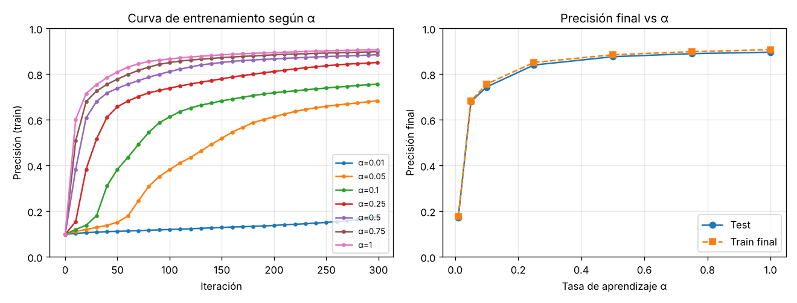
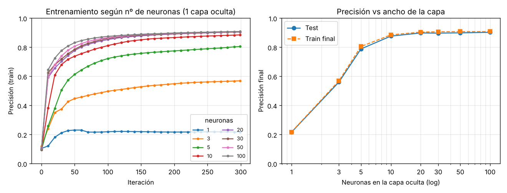
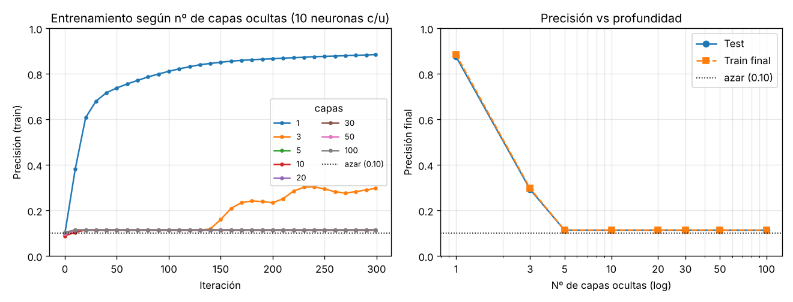

# NN · MNIST — Sensibilidad a hiperparámetros

Afianzamiento de conceptos de redes neuronales sobre el clásico **MNIST**, partiendo
del notebook de marimo `mnist.py` (una red `784 → 10 (sigmoid) → 10 (softmax)`
entrenada con descenso de gradiente *full-batch*).

El objetivo es responder, usando **la precisión como guía** y gráficas de matplotlib:

1. ¿Cómo afecta el parámetro **`alpha`** (tasa de aprendizaje, entre 0 y 1) al entrenamiento?
2. ¿Qué tan sensible es la red a **más neuronas** en la única capa oculta? `(1, 3, 5, 10, 20, 30, 50, 100)`
3. ¿Qué tan sensible es la red a **más capas ocultas**? `(1, 3, 5, 10, 20, 30, 50, 100)`

## Cómo reproducir

```bash
# 1. Descomprimir el dataset MNIST crudo en ./data/MNIST/raw
#    (mismos ficheros idx que descarga torchvision en mnist.py)
# 2. Ejecutar los experimentos (genera figures/results.json)
python3 experiments.py ./data/MNIST/raw ./figures
# 3. Generar las gráficas a partir del JSON
python3 plots.py ./figures
```

`experiments.py` generaliza la red del notebook a una arquitectura
`[784] + [h]*L + [10]` para poder variar ancho (`h`) y profundidad (`L`), y
mide la precisión de *train* (cada 10 iteraciones) y de *test* al final. Se usa
inicialización tipo Xavier (`randn * sqrt(1/fan_in)`) para que la comparación
entre profundidades sea justa, 20 000 ejemplos de entrenamiento / 5 000 de test
y 300 iteraciones por configuración.

---

## 1. Efecto de `alpha` (tasa de aprendizaje)



Código matplotlib (extracto de `plots.py`):

```python
fig, (ax1, ax2) = plt.subplots(1, 2, figsize=(11, 4.2))
for a, v in alpha:                      # una curva por cada alpha
    ax1.plot(v["it"], v["train"], marker='o', ms=3, label=f"α={a:g}")
ax1.set(xlabel="Iteración", ylabel="Precisión (train)", ylim=(0, 1))
ax1.grid(alpha=.3); ax1.legend()

xs = [a for a, _ in alpha]
ax2.plot(xs, [v["test"] for _, v in alpha], 'o-', label="Test")
ax2.plot(xs, [v["final_train"] for _, v in alpha], 's--', label="Train final")
ax2.set(xlabel="Tasa de aprendizaje α", ylabel="Precisión final", ylim=(0, 1))
```

| α     | 0.01 | 0.05 | 0.1  | 0.25 | 0.5  | 0.75 | 1.0  |
|-------|------|------|------|------|------|------|------|
| train | 0.18 | 0.68 | 0.76 | 0.85 | 0.89 | 0.90 | 0.91 |
| test  | 0.17 | 0.68 | 0.74 | 0.84 | 0.88 | 0.89 | 0.90 |

**Lectura:** `alpha` controla el *tamaño del paso* del descenso de gradiente.
Con `alpha` muy pequeño (0.01) la red apenas se mueve en 300 iteraciones y queda
cerca del azar; al crecer `alpha` el aprendizaje se acelera y la precisión sube de
forma monótona hasta ~0.90. Las curvas de la izquierda muestran que el efecto es
sobre todo de **velocidad de convergencia**: con `alpha` alto la red llega antes al
mismo techo. En este rango no se observa divergencia (la *softmax + cross-entropy*
es estable), pero la ganancia marginal entre 0.75 y 1.0 ya es pequeña.

## 2. Sensibilidad al número de neuronas (1 capa oculta)



| neuronas | 1    | 3    | 5    | 10   | 20   | 30   | 50   | 100  |
|----------|------|------|------|------|------|------|------|------|
| test     | 0.22 | 0.56 | 0.79 | 0.88 | 0.90 | 0.90 | 0.90 | 0.90 |

**Lectura:** el ancho de la capa oculta define la **capacidad** de la red.
Con 1–3 neuronas hay *underfitting* severo: no hay suficientes "detectores de
rasgos" para separar 10 dígitos. La precisión crece rápido hasta ~10–20 neuronas
y luego **satura** en una meseta de ~0.90: añadir más neuronas (50, 100) casi no
mejora, porque el cuello de botella ya no es la capacidad sino la arquitectura
(una sola capa, pocas iteraciones). La brecha train–test se mantiene mínima: aún
no hay sobreajuste apreciable.

## 3. Sensibilidad al número de capas ocultas (10 neuronas c/u)



| capas | 1    | 3    | 5    | 10   | 20   | 30   | 50   | 100  |
|-------|------|------|------|------|------|------|------|------|
| test  | 0.88 | 0.29 | 0.11 | 0.11 | 0.11 | 0.11 | 0.11 | 0.11 |

**Lectura (el resultado más interesante):** apilar más capas **no** mejora;
de hecho **degrada** y colapsa al azar (0.11 ≈ 1/10). Con `sigmoid` en cada capa,
la derivada `σ'(a) = a(1-a)` vale como máximo 0.25, así que al retropropagar a
través de muchas capas el gradiente se multiplica por factores < 1 repetidamente
y se **desvanece** (*vanishing gradients*): las capas iniciales casi no reciben
señal y la red se queda estancada en la predicción constante. Ya con 5 capas la
red es intratable con este esquema clásico.

> Este experimento motiva por qué las redes profundas modernas **no** se entrenan
> así: usan activaciones **ReLU** (derivada 1 en la zona positiva), inicialización
> adecuada (He), *batch/layer normalization* y conexiones residuales (*skip
> connections*), precisamente para que el gradiente sobreviva la profundidad.

---

## Conclusiones

- **`alpha` → velocidad.** Es el paso del descenso de gradiente. Demasiado
  pequeño = aprendizaje lentísimo (parece que "no aprende"); subirlo acelera la
  convergencia hacia el mismo techo. El mejor valor del barrido fue el extremo
  alto (`α ≈ 0.75–1.0`), sin señales de inestabilidad gracias a *softmax + CE*.
- **Ancho → capacidad, con rendimientos decrecientes.** Pasar de 1 a ~10–20
  neuronas es decisivo; más allá de 20 la precisión satura (~0.90). Más neuronas
  cuestan cómputo sin pagar en precisión para esta tarea y presupuesto de
  iteraciones.
- **Profundidad ≠ mejor (con sigmoid).** Más capas no ayudan y rápidamente hacen
  que la red colapse al azar por *vanishing gradients*. La profundidad solo es
  útil con las herramientas modernas (ReLU, normalización, residuales).
- **Regla práctica sobre MNIST:** una única capa oculta de ~20–30 neuronas,
  `sigmoid`, `softmax + cross-entropy` y `α ≈ 0.5–1.0` ya alcanza ~90% de forma
  robusta y barata — un buen punto de partida antes de complicar la arquitectura.

_Datos: 20 000 ejemplos de entrenamiento, 5 000 de test, 300 iteraciones
full-batch, semilla fija. Las cifras exactas están en `figures/results.json`._
